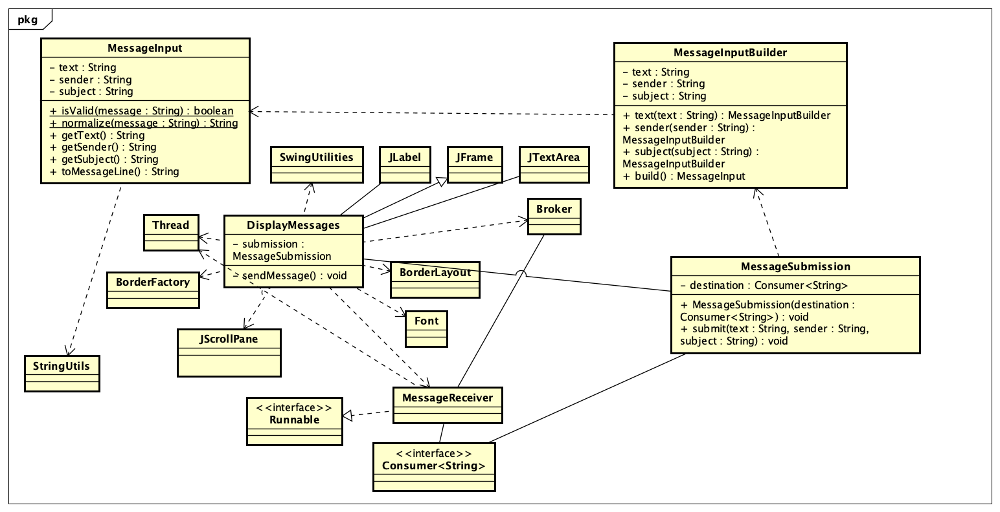

# Message Input Processing — Sprint 3

Author: Matthew Davi  
Story: #242  
Tasks: #288, #289, #290

## Design problem

The original MessageInput only checked for blank text and trimmed whitespace.
It had no metadata model or production callers.

Text alone did not justify Builder. Adding optional sender and subject fields
introduces configuration choices and a cross-field rule: a subject requires a
sender. Builder centralizes these checks before constructing an immutable message.

## Implementation

- MessageInput stores immutable text, sender, and subject values.
- MessageInputBuilder provides fluent text(), sender(), subject(), and build()
  methods. Validation happens in build().
- MessageSubmission builds and validates input before forwarding formatted output.
- DisplayMessages uses MessageSubmission in its Send action and preserves the
  existing received-message display.

Each class is in a separate Java file. The original static isValid() and
normalize() methods retain their behavior.

## Validation rules

- Message text is required, nonblank, and trimmed.
- Sender and subject are optional; supplied values must be nonblank and trimmed.
- A subject requires a sender.
- Constructed fields cannot contain carriage returns or newlines because Broker
  sends one message per line.
- Blank optional GUI controls are treated as omitted metadata.
- Invalid input is rejected before reaching the sending destination.

## Before and after

Before, isValid("  Hello  ") returned true and normalize("  Hello  ") returned
"Hello". Both results remain unchanged.

After refactoring, the application can also construct and submit:

| Text | Sender | Subject | Submitted output |
| --- | --- | --- | --- |
| `  Hello  ` | omitted | omitted | `Hello` |
| `Hello` | `Matthew` | omitted | `Matthew: Hello` |
| `Hello` | `Matthew` | `Study group` | `Matthew [Study group]: Hello` |
| `Hello` | omitted | `Study group` | Rejected; nothing sent |

## Automated verification

Run from the repository root:

```bash
mvn clean verify
```

MessageInputBehaviorTest contains 11 JUnit tests covering compatibility,
normalization, optional metadata, invalid combinations, line breaks, immutability,
and the submission service used by the GUI.

The build passed with 14 tests total: 11 feature tests and 3 instructor
Blackboard tests, with zero failures or errors.

## Reproducible GUI demonstration

Prepare the runtime classpath:

```bash
mvn dependency:build-classpath -Dmdep.outputFile=target/classpath.txt
```

In one Terminal, start the instructor's sending test receiver:

```bash
java -cp "target/classes:target/test-classes:$(cat target/classpath.txt)" edu.calpoly.test.sprint1.TestEnterMessage
```

In another Terminal, start the application:

```bash
java -cp "target/classes:$(cat target/classpath.txt)" edu.calpoly.messages.DisplayMessages
```

Enter Hello, sender Matthew, and subject Study group. Click Send.
The receiver prints:

```text
Received: Matthew [Study group]: Hello
```

Re-enter Hello, clear the sender, and keep the subject.
The application displays "A subject requires a sender." and sends nothing.

To check receiving, close the application and stop TestEnterMessage with
Control+C. Start the display simulator:

```bash
java -cp "target/classes:target/test-classes:$(cat target/classpath.txt)" edu.calpoly.test.sprint1.TestDisplayMessages
```

Restart DisplayMessages. Messages including "Hello!", "How are you?", and
"CSC 3100" appear in order.

Both sending/validation and the original receiving display were checked manually.

## UML

The original Astah diagram was updated and exported over the existing image:

